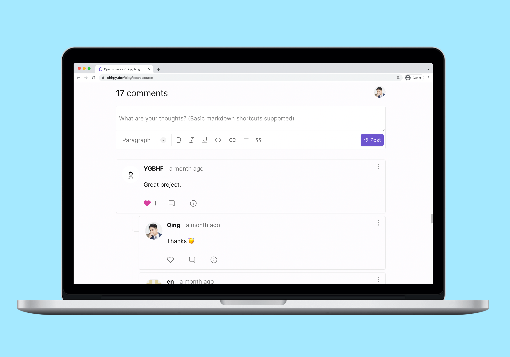
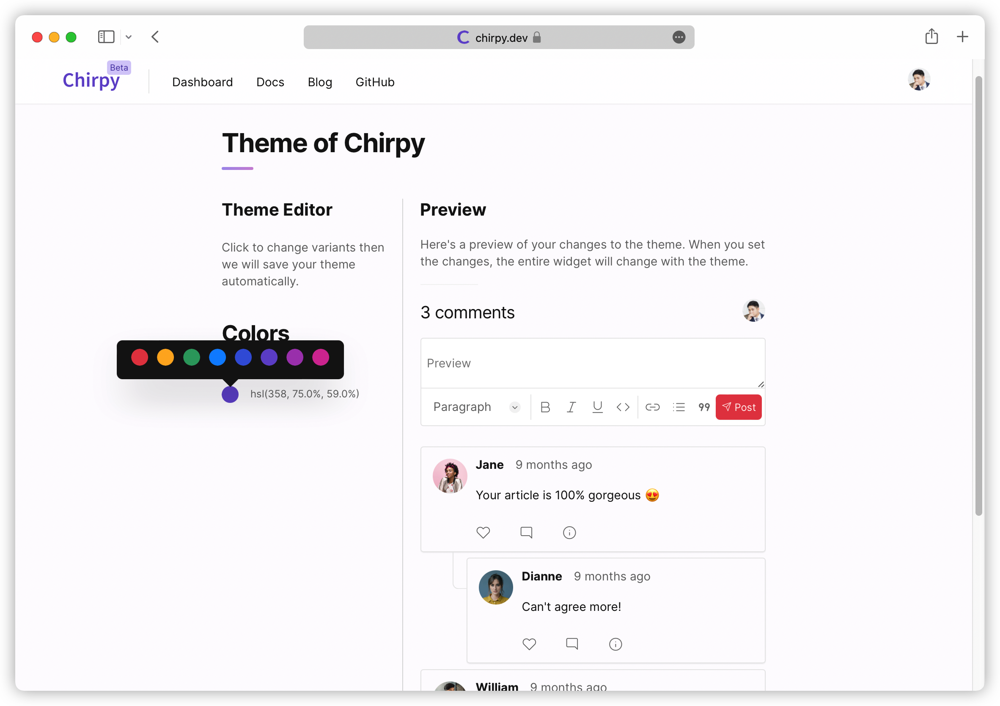
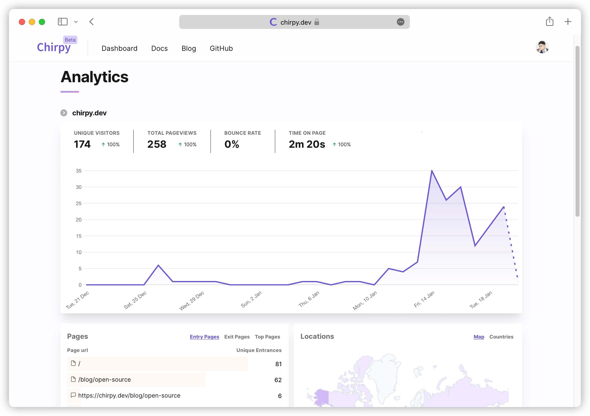
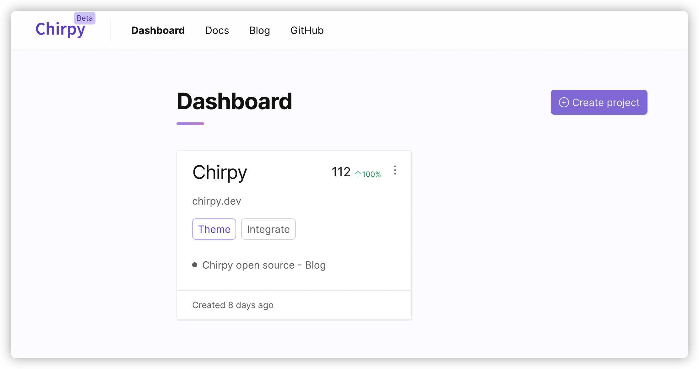
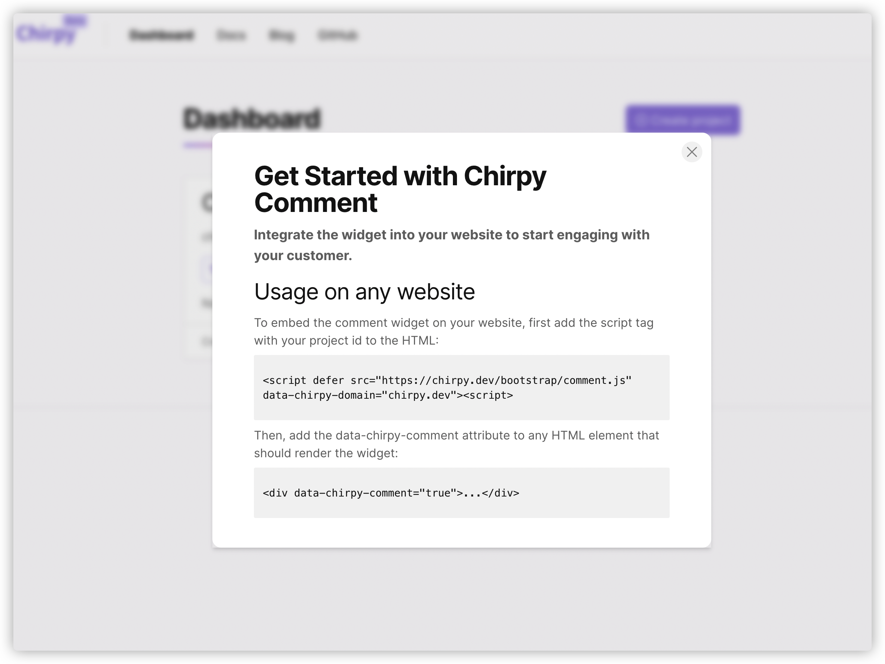
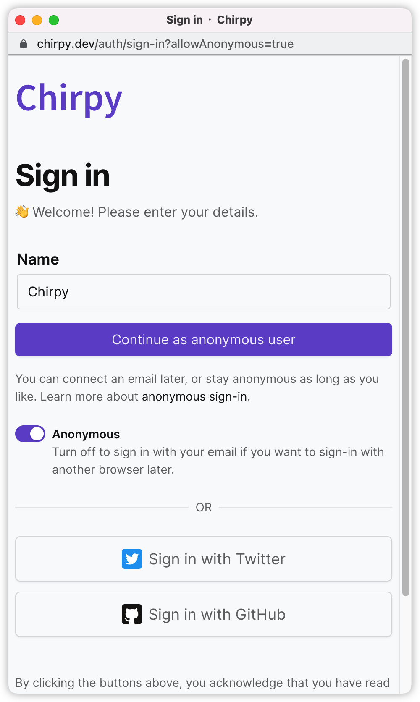
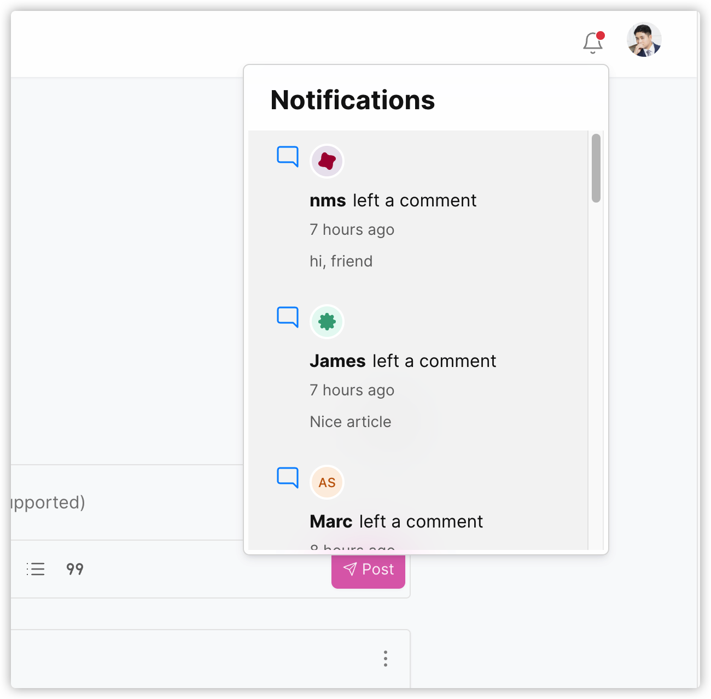
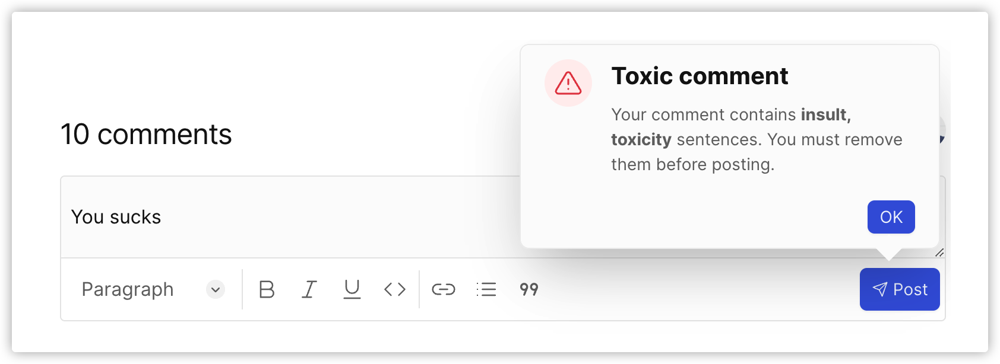

# Chirpy

👋 [Chirpy](https://chirpy.dev) 是一个注重隐私保护和定制化的评论系统, 支持 vercel 部署。在这里体验： [Playground](https://chirpy.dev/play).

    
更多截图

    
    
    
    
    
    
    

 

喜欢我们的产品？ 请务必给 Chirpy 一个 ⭐，这对我们帮助非常大，非常感谢 🙏。

## ✨ 关键特性

- 🔒 注重隐私保护
- 🎨 [支持组件 UI 定制](https://chirpy.dev/docs/features/theme)
- ✍️ 富文本编辑 & [Markdown](https://chirpy.dev/docs/features/markdown)
- 📊 [组件统计](https://chirpy.dev/docs/features/analytics)
- 🪄 实时评论
- 📱 适配移动端设计
- 🔔 [邮件和 Web 推送通知](https://chirpy.dev/docs/features/notifications)
- 🤐 [自动过滤有毒评论](https://chirpy.dev/docs/features/anti-toxic-comment)
- 💬 [评论管理](https://chirpy.dev/docs/features/moderation)
- 🎭 [匿名登陆](https://chirpy.dev/docs/features/privacy-friendly#anonymous-sign-in)
- 📬 [Email 登陆](https://chirpy.dev/docs/features/privacy-friendly#email-sign-in)

## 🧭 产品路线

尽管 Chirpy 已经可以服务您和您的客户，我们正在努力开发更多功能来满足您的需求：

- 更多 UI 定制项
- 更多账户计划
- 支付

## 📀 自托管

你可以[自托管](https://chirpy.dev/docs/self-hosted) Chirpy 实例。 它和我们的云服务是相同的。请知悉，你需要至少 2 个服务器和 2 个域名来安装和运行多个服务端软件。

## 🍡 技术栈

- 
- 
- 
- 
- 
- 
- 
- [next-auth](https://github.com/nextauthjs/next-auth)
- [tiptap](https://tiptap.dev)
- [Plausible](https://github.com/plausible/analytics)

## 🥇 开源贡献

我们非常欢迎你参与贡献本项目， 请参考[贡献](CONTRIBUTING.md) 指南。

## 🚀 部署平台

## 💅 UI 设计

- 本产品颜色参考了[radix color](https://www.radix-ui.com/colors)
- 首页参考了[stitches](https://stitches.dev/)

## ⚖️ 许可证

AGPL 3.0

## 作者的其他产品

[Layerwise](https://layerwise.app) — 在电脑上用 AI 构建全栈应用，实时预览并发布上线。
